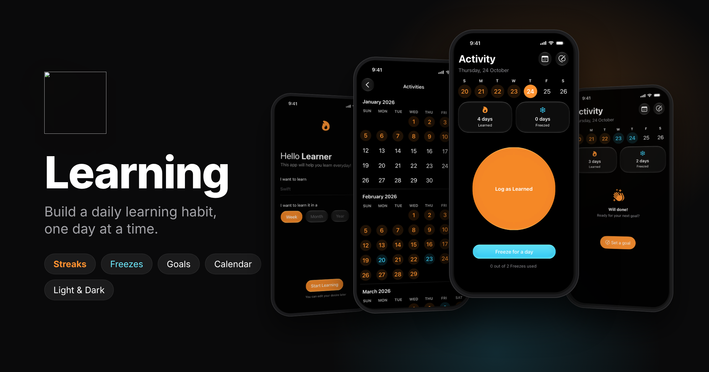
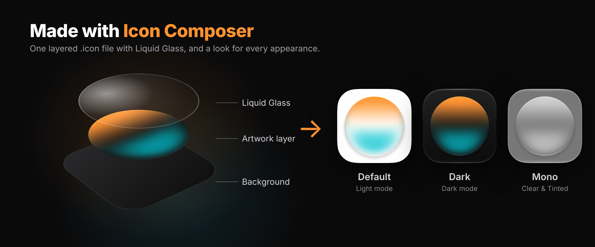
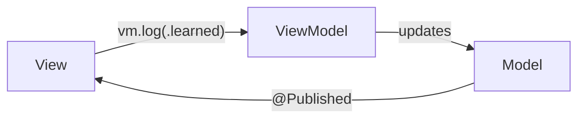

<p align="center">
  <b>An iPhone app that turns learning into a daily habit.</b><br>
  Pick what you want to learn, log every day you learn, and keep your streak alive.
</p>

<p align="center">
  
  
  
</p>

---

## Features

| Feature | Description |
|---|---|
| **Goals** | Learn something in a week, a month or a year |
| **Daily streak** | One tap to log a learning day |
| **Freezes** | Skip a day without losing the streak: Week 2, Month 8, Year 96 |
| **Streak rule** | Resets after 32 hours with no log or freeze, or when the goal changes |
| **Calendar** | Every logged day grouped by year, each goal duration in its own shade |
| **Notifications** | Freezes left, and two reminders before the streak is lost |
| **Light & Dark** | The app and its icon follow the system appearance |

---

## App icon



Built with **Icon Composer**, Apple's tool for Liquid Glass app icons. One `.icon` file holds every appearance, and iOS picks the right one automatically:

- **Default** for light mode
- **Dark** for dark mode
- **Mono** for Clear and Tinted icons, chosen from *Home Screen > Edit > Customize*

[Icon Composer](https://developer.apple.com/icon-composer/) · [Creating your app icon](https://developer.apple.com/documentation/xcode/creating-your-app-icon-using-icon-composer) · [HIG: App icons](https://developer.apple.com/design/human-interface-guidelines/app-icons) · [WWDC25 session](https://developer.apple.com/videos/play/wwdc2025/361/)

---

## Architecture: MVVM



| Layer | Role | Files |
|---|---|---|
| **Model** | The data | `LearningModel` |
| **ViewModel** | The logic and the state | `LearningViewModel`, `NotificationManager` |
| **View** | The UI | `OnboardingView`, `ActivityView`, `LearningGoalView`, `CalendarView` |

**Why MVVM?**
- All the rules (streak, freezes, 32 hours) live in one place, so a rule can change without touching the UI.
- One shared ViewModel keeps the data the same on every screen.
- It fits SwiftUI: `ObservableObject` and `@Published` redraw the views automatically.

---

## Project structure

```
Learning App
├── Model
│   └── LearningModel.swift        # Goal, DayLog, GoalDuration
├── ViewModel
│   ├── LearningViewModel.swift    # Streak, freezes, goals, calendar, saving
│   └── NotificationManager.swift  # Local notifications
├── View
│   ├── OnboardingView.swift
│   ├── ActivityView.swift
│   ├── LearningGoalView.swift
│   ├── CalendarView.swift
│   ├── Components.swift           # Shared UI and the update alert
│   └── Theme.swift                # App colors
├── LJ_Icon.icon                   # App icon
└── MyApp.swift                    # Entry point
```

### Key functions

| Function | What it does |
|---|---|
| `log(_:)` | Logs today as learned or freezed |
| `setGoal(topic:duration:)` | Starts a new goal, old days stay in the calendar |
| `streak` | Counts learned days in a row |
| `streakDeadline` | When the streak will be lost |
| `canFreeze` | Checks if a freeze is allowed today |
| `months(in:)` · `days(in:)` | Build the calendar with `for` loops |

---

## Built with

| Framework | Apple documentation |
|---|---|
| **SwiftUI** | [State](https://developer.apple.com/documentation/swiftui/state) · [Binding](https://developer.apple.com/documentation/swiftui/binding) · [StateObject](https://developer.apple.com/documentation/swiftui/stateobject) · [EnvironmentObject](https://developer.apple.com/documentation/swiftui/environmentobject) · [NavigationStack](https://developer.apple.com/documentation/swiftui/navigationstack) · [LazyVGrid](https://developer.apple.com/documentation/swiftui/lazyvgrid) |
| **Combine** | [ObservableObject](https://developer.apple.com/documentation/combine/observableobject) · [Published](https://developer.apple.com/documentation/combine/published) |
| **Foundation** | [Calendar](https://developer.apple.com/documentation/foundation/calendar) · [DateFormatter](https://developer.apple.com/documentation/foundation/dateformatter) · [UserDefaults](https://developer.apple.com/documentation/foundation/userdefaults) · [Codable](https://developer.apple.com/documentation/swift/codable) |
| **UserNotifications** | [UNUserNotificationCenter](https://developer.apple.com/documentation/usernotifications/unusernotificationcenter) |

---

## Getting started

1. Clone the repository.
2. Open `Learning.xcodeproj` in **Xcode 26** or later.
3. Choose an iPhone simulator and press `Cmd + R`.
